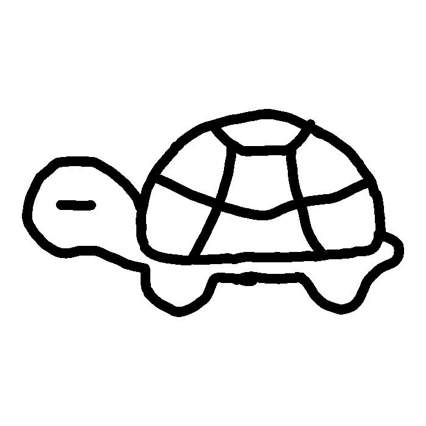

<p align="center"></p>

# DER/32

**DER/32** ("Derivative 32") is a NetBSD-derived Unix operating system for
amd64. It has its own system identity, release engineering and kernel
configuration, and a native package manager, **upkg**.

```
DER/32 UNIX Operating System
Release 0.1 — Genesis

der32/amd64 (tty00)

login:
```

* NetBSD 10 kernel, libc and userland, kept close to upstream and
  maintained as an auditable patch series (`patches/`) on a pinned NetBSD
  commit (`UPSTREAM`).
* Traditional Unix: BSD `init` + `rc.d`, POSIX `/bin/sh`, FFS, plain-text
  configuration, text console. No systemd, no service manager, no
  mandatory GUI.
* `uname -s` → `DER32`, the kernel version string `DER/32 0.1 GENESIS`, and
  `sysctl kern.der32.*` are all implemented in the kernel build, not
  patched-in strings.
* **upkg**: a multi-repository package manager written in C. It has
  Ed25519-signed indexes, SHA-256 verified packages, dependency resolution,
  conflict detection, repository priorities, crash-safe transactions on
  SQLite, and unprivileged source builds.

## Mascot

Meet **Genesis**, the DER/32 tortoise: slow, steady, carries its house on
its back. The original drawing is in [`docs/art/genesis.png`](docs/art/genesis.png).
A fastfetch logo version is in [`share/fastfetch/`](share/fastfetch/README.md):

```
                   _.-''''''-._
               .-'  \________/  '-.
             .'      |      |      '.
   .---.    /--------'      '-------\
  /     \  |      /  '-.__.-'  \     |
 |  --   '-|_____/______________\____|_.
  '-.________________________________ __)
             |  |               |  |
             '--'               '--'
```

## Build

On Arch Linux (or any Linux/BSD host, no root needed):

```sh
sudo pacman -S --needed base-devel git xz python pkgconf \
    libarchive sqlite openssl curl qemu-base
git clone --recurse-submodules --shallow-submodules https://github.com/luciferindev/der-32
cd der-32
make check     # host report
make release   # toolchain, kernel, userland, sets, test repos, image, ISO
make test      # automated tests, including a full QEMU boot
make qemu      # boot it: login root / password der32, Ctrl-A X to quit
```

The individual targets are `make tools kernel world sets repo image iso`.
See [docs/building.md](docs/building.md).

## upkg in one minute

```sh
upkg sync                       # verify + cache every repository index
upkg install lua-hello          # resolves lua from core, lua-hello from extra
upkg install community/der32-hello   # explicit repository selection
upkg remove lua                 # refused: lua-hello depends on it
upkg remove lua-hello && upkg autoremove
upkg repo add web https://example.org/der32/core -p 90
```

See [docs/packages.md](docs/packages.md) for the package and repository
formats, the trust model and the transaction design.

## Layout

| path | |
|---|---|
| `UPSTREAM`, `src/`, `patches/` | pinned NetBSD + the DER/32 patch series |
| `upkg/` | package manager (C), test suite, man page |
| `ports/` | source recipes (`upkg build`) |
| `repos/` | repository tiers: core, extra, community |
| `conf/` | build profile (`mk.conf`) and default `/etc/upkg` |
| `scripts/` | build, image, ISO, repository, QEMU and test drivers |
| `share/fastfetch/` | fastfetch logo + config (Genesis) |
| `docs/` | [architecture](docs/architecture.md), [building](docs/building.md), [packages](docs/packages.md), [roadmap](docs/roadmap.md), [development log](docs/devlog.md) |

## Status

0.1 Genesis is under active development. The development log
([docs/devlog.md](docs/devlog.md)) records what has been verified and how,
and [docs/roadmap.md](docs/roadmap.md) lists what remains.

## Licence

DER/32's own code is BSD-2-Clause. NetBSD code keeps its original licences
and notices. See [LICENSES/](LICENSES/README.md).
